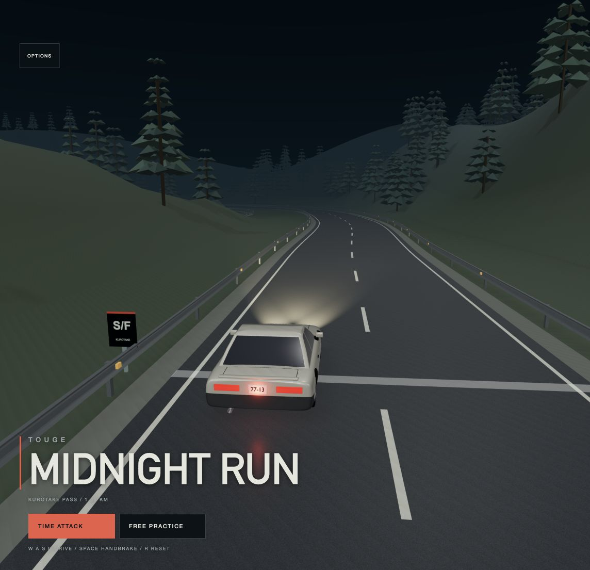

# TOUGE: Midnight Run

A Three.js and Rapier mountain-pass racing game with a custom four-ray vehicle,
automatic gears, handbrake drifting, a chase camera and keyboard/touch controls.
Time Attack includes a countdown, checkpoints, splits, drift scoring and saved
personal bests. Tire smoke, skid marks and vehicle sounds follow actual physics.



## Run locally

The runtime models and music are included. You need Node.js and npm; no API key
or Blender installation is required to play.

```sh
npm ci
npm run typecheck
npm test
npm run dev
```

Open the local URL printed by Vite. For a built preview:

```sh
npm run build
npm run preview
```

## Controls

| Input | Action |
| --- | --- |
| W / S | Accelerate / brake, then reverse |
| A / D | Steer |
| Space | Handbrake |
| R | Reset to Practice |
| Options | Pause, graphics and audio settings, race selection |

Touch devices receive steering and pedal buttons. Choose Low graphics for a
lighter rendering preset. Development builds also expose a Practice tuning
panel; Time Attack restores stock settings before starting.

## Assets and validation

- [Blender generators](tools/blender/README.md): editable coupe and course scripts.
- [Original synthesized music](docs/MUSIC.md): generator, CC0 licensing and asset specifications.
- [Validation report](docs/final-validation.md): 233 tests, physical-lap evidence,
  measured desktop performance and remaining device checks.

Vehicle SFX and music use original synthesis and are labelled temporary assets.
The physics runs at 60 Hz with interpolated rendering. Rapier is pinned to
`@dimforge/rapier3d-compat@0.14.0`. Last local validation used Node.js 26.3.1.
