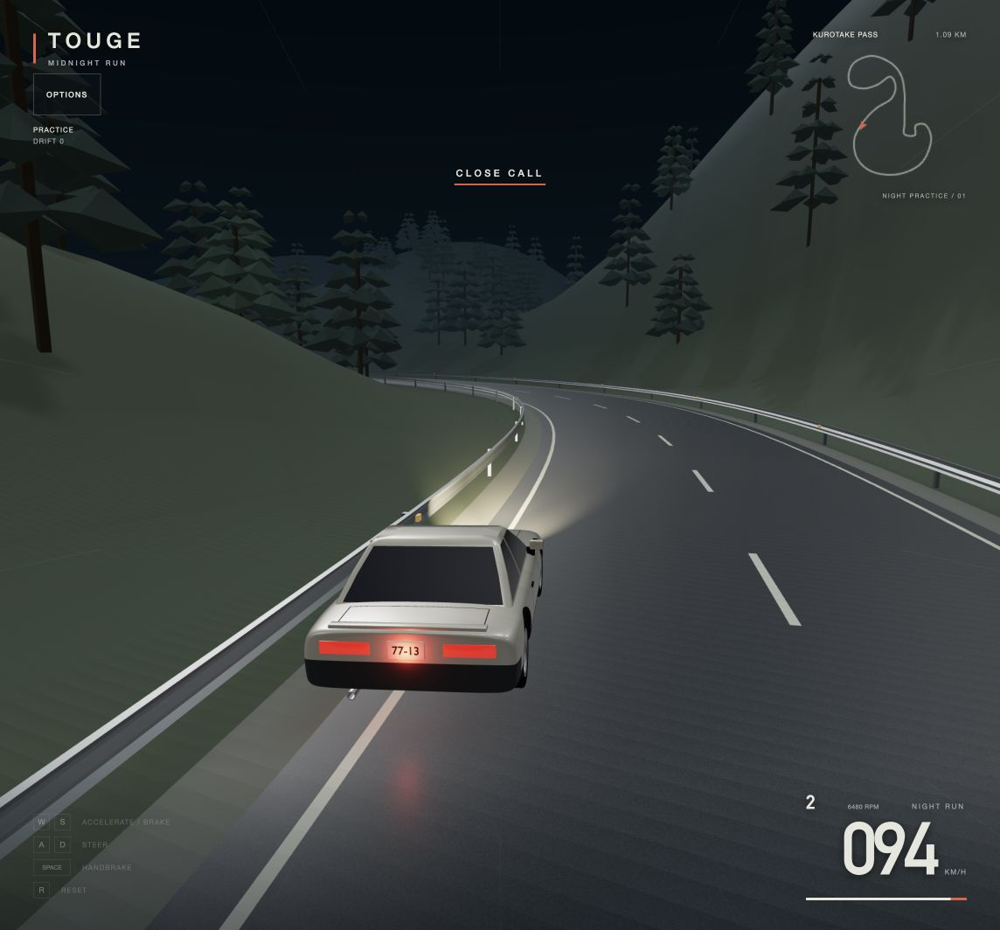
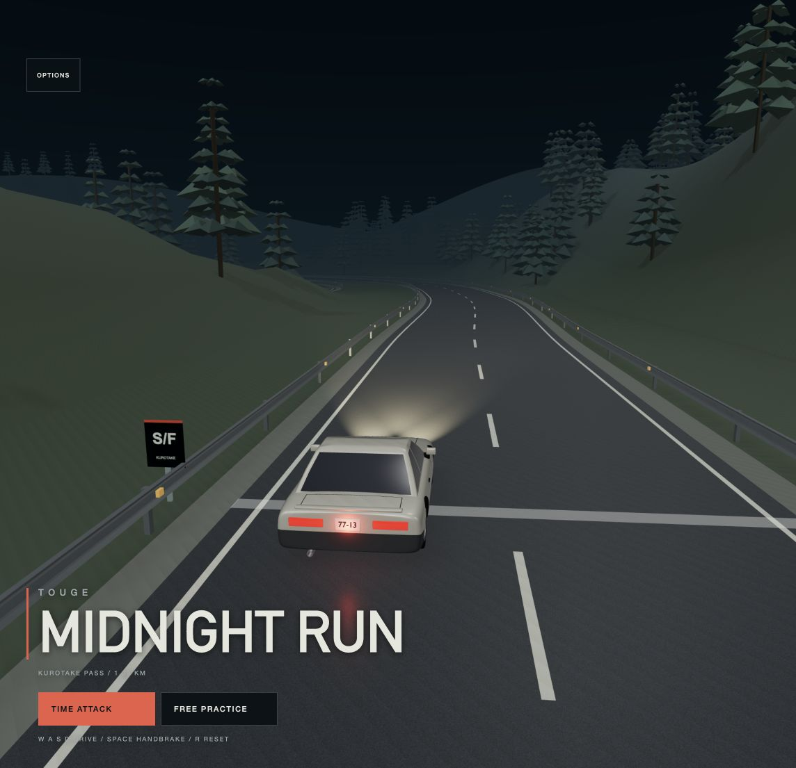

# Final game validation

The existing game now has progressive tire breakaway and handbrake recovery,
automatic torque/gearing/RPM, bounded speed camera effects, pooled slip-driven
smoke/skid marks, real impact/near-miss/rail-scrape feedback, synthesized vehicle
SFX and four playable original music files. Time Attack adds synchronized
countdown, three checkpoints, splits, drift score and validated personal bests.
Keyboard/touch controls remain available. The title screen, Options, Low preset
and development-only practice tuning preserve the existing architecture.

## Evidence

- `npm run typecheck`: pass, with Rapier exactly0.14.0 and its own declarations.
- `npm test`:233 pass,0 fail. Native Rapier/Three and focused deterministic rules.
- `npm run build`:pass. The existing large-bundle warning remains:2.70MB JS,
  about0.94MB gzip including the compat WASM. It has not been hidden.
- Runner offline tests:19 pass,0 fail, including costs/locks/secrets/path guards.
- [Physical lap and render measurements](evidence/physical-lap.json):70.165765s,
  valid/all3 checkpoints/PB stored/no off-road time. Driver uses normal inputs,
  with no pose/velocity edits. Test PB storage is isolated from the user's PB.
- Moving300 frames:120FPS, frame p95 9.6ms/p99 10.3ms, callback p95 2.4ms.
  M1 Max,10 cores,64GB, Chrome at120Hz,1144x1049 CSS, High DPR1.75. Short local
  sample; not a cross-device benchmark. Final asset read was cached (300bytes
  transferred); encoded track is4,874,419bytes, so this is not a cold-load timing.
- GPU resources stable within that moving window. After viewing the whole lap:
  199buffers,11textures,2framebuffers,2renderbuffers,12programs,4shaders,135VAOs;
  later finished samples plateau. Full heap/leak profiling remains a manual task.
- [Actual near pass](evidence/near-miss.json):93.55km/h, four loaded wheels,
  two broad-phase pairs, zero solver contacts, one feedback event. Both sides
  also pass a regression using the actual exported corrugated GLB collider.

## Browser integration

- W enters Practice from title immediately. Mouse and Enter selection blur the
  hidden button; Options summary close/Enter returns keyboard focus to driving.
- Time Attack remains neutral through3/2/1 even withW held. Options freezes the
  simulation/race clock. R cancels to Practice and snaps histories/camera.
- Simulated touch: six holds disabled on title/Options, enabled in Practice,
  no stale holds after transitions. GAS1.5s reaches28km/h. Physical phone pending.
- Menu bounds verified at320/375/414/768px and568x320 landscape; both actions48px.
  Near-miss text fits between Options/map at320x480 and clears HUD at568x320.
- DEV tuning validates atomically; real body1500kg/-0.15m COM applied; Time Attack
  restores1200kg/COM0/stock torque and panel values. All16 numeric inputs are48px.
- Audio unlocks on a gesture; menu->prepare->race music played with bounded nodes.
  Real sliding contact drove the added scrape branch. Graph stable111s including
  contacts/reset:14gains,6filters,5oscillators,5noise sources,2media sources.
  Options zeroes scrape and suspends context. Mute gives RMS0/peak0; preference
  restored. Native deferred promises cover pause/stale completion/back-to-A.
- Startup keyboard regression: while actual parallel compiler status is held
  pending, ready stays unset and menu/Options are inert (not keyboard reachable).
  Before the fix, Tab/Enter produced3/countdown before the clock began.
- No warnings/errors in the measured game, near-pass and audio browser checks.

## Budget and remaining work

Runner cap:$100 cumulative, model `claude-fable-5-2`, output limit128000.
Estimated usage:$61.658016, remaining$38.341984.91request ledger history preserved;
no in-flight request or lock. Cost is a local estimate, not a provider billing cap.
The feature guard retained$5 for final validation; unused authorization is retained.

Human driving/audio judgment, physical iOS/Android/autoplay/background/bfcache
checks and a longer heap profile remain. Synth vehicle sounds are labelled
placeholders; the original generated MP3s are playable and verified but not
represented as studio recordings. Optional motion blur/replay/ghost and manual
shifting are not implemented; no artificial drift/yaw assist was added.
Production check: the existing tunnel now serves Vite preview on127.0.0.1:5173,
with the final hashed bundle `index-8a1hgux9.js` (HTTP200). Chrome loaded the game
and drove in Low after closing Options with the mouse (19km/h after1s ofW).
The development tuning panel is absent. Original High preference was restored,
the title screen is left open, and there are no console warnings/errors.
Temporary QA fixtures were removed. The production server and tunnel remain
running. Local development tuning can be used with `npm run dev -- --port5174`.

